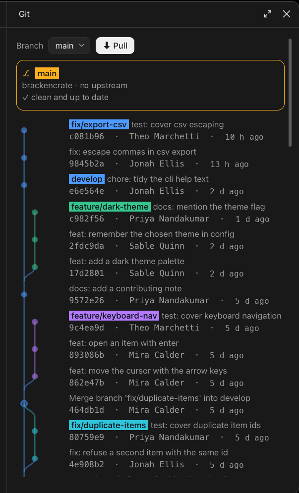
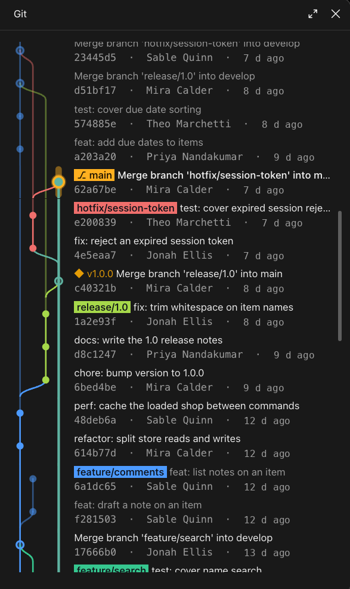

# git-tree

A [Claude Code](https://claude.com/claude-code) mod that adds a **git sidebar**: the commit graph with coloured branch lanes, merges and tags, the current branch highlighted, a branch selector and a Pull button. It refreshes by itself after every commit, pull, push or merge.

Preview and walkthrough: <https://git-tree-cc.vercel.app>

<p align="center">
  
  
</p>

## What you get

- **Commit graph**: lanes per branch, merge commits, tags and remote refs, newest first, 200 commits at a time (`Show 200 more commits` loads more).
- **Branch header**: current branch, upstream, ahead/behind counters and a summary of staged, modified, untracked and conflicting files.
- **Branch selector**: switch to any local branch listed in the pane (runs `git switch`).
- **Pull button**: runs `git pull --no-edit` (never waits for a prompt) and reports the result as a toast. Shows `⬇ Pull (N)` when you are N commits behind.
- **Live updates**: the pane re-reads the repository every 3 seconds, right after any shell command Claude runs, and at the end of every turn.

## Prerequisites

- Claude Code with plugin support (`/plugin` available) and sidebar panes.
- `git` on your `PATH`.
- A git repository as the working directory of your session. Outside a repo the pane just says so.

No build step and no extra dependencies: the plugin is plain TypeScript loaded by Claude Code.

## Install

Inside Claude Code, run these two commands:

```text
/plugin marketplace add zaninifrancesco/git-tree
/plugin install git-tree@local-mods
```

`local-mods` is the marketplace name defined in [`.claude-plugin/marketplace.json`](.claude-plugin/marketplace.json) and `git-tree` is the plugin name. Restart Claude Code (or start a new session) after installing if the pane does not appear.

### Update and uninstall

```text
/plugin marketplace update local-mods
/plugin uninstall git-tree@local-mods
```

## Open the sidebar

The pane opens automatically when a session starts. If you closed it, run:

```text
/git-tree
```

## Usage

- **Switch branch**: open the selector at the top of the pane and pick a branch. If git refuses (for example because of local changes that would be overwritten), the reason is shown in a toast and nothing changes.
- **Pull**: press `⬇ Pull`. Only one pull or switch runs at a time; the button reads `Working…` while it works.
- **Read the tree**: the highlighted pill with `⎇` is the branch you are on, coloured pills are other local branches, `◆` marks tags, dimmed coloured text is a remote ref. Commits not reachable from the current branch are dimmed.
- **Refresh now**: press `Refresh` at the bottom of the pane.
- In terminals that cannot draw SVG the graph falls back to box-drawing characters on a single line per commit.

## Troubleshooting

**`/plugin marketplace add` fails with an authentication or "repository not found" error**
The repository is public, so no credentials are needed. If you still see this, git is probably sending stale or invalid credentials for github.com. Check that you can clone it anonymously:

```bash
git ls-remote https://github.com/zaninifrancesco/git-tree.git
```

If that fails, fix or remove the stale credential (macOS Keychain, `gh auth logout`, a credential helper, or an `insteadOf` rule rewriting GitHub URLs to SSH) and retry. If you previously added this marketplace while the repo was private and it is stuck in a failed state, remove it and add it again:

```text
/plugin marketplace remove local-mods
/plugin marketplace add zaninifrancesco/git-tree
```

**Install says the plugin is not found in the marketplace**
Refresh the marketplace with `/plugin marketplace update local-mods`, then install again. The install name must be exactly `git-tree@local-mods`.

**The sidebar does not show up**
Restart Claude Code, then run `/git-tree`. Make sure the plugin is enabled in `/plugin`.

**The pane says there is no repository**
The session's working directory is not inside a git repository. Start Claude Code from a repo folder.

**The tree looks stale**
Press `Refresh`. The pane polls every 3 seconds; very long histories only load 200 commits until you ask for more.

## Development

```text
.claude-plugin/plugin.json        plugin manifest
.claude-plugin/marketplace.json   marketplace `local-mods` that lists this plugin
hooks/hooks.json                  module entry point
hooks/register.tsx                command, polling and the pane UI
hooks/git.ts                      git probing, graph loading, pull and switch
hooks/draw.ts                     SVG and box-drawing rendering of the lanes
hooks/register.test.tsx           pane tests
types/index.d.ts                  types for the `claude-code` module
```

To try local changes, add the checkout as a marketplace instead of the GitHub one:

```text
/plugin marketplace add /path/to/git-tree
/plugin install git-tree@local-mods
```

If you like it, a star on GitHub is appreciated.
